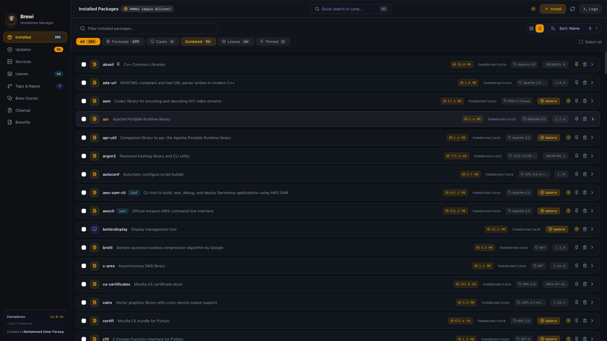

<p align="center">
  
</p>

<h1 align="center">Brewi 🍺</h1>

[](LICENSE)
[](https://apple.com/macos)
[](https://tauri.app)
[](https://www.rust-lang.org)
[](https://react.dev)

**Brewi** is a modern, ultra-sleek macOS Homebrew GUI manager built with **Rust**, **Tauri v2**, and **React 19**.


<p align="center">
  
</p>


## 📦 Installation

```bash
brew install --cask brewi
```

Or download the latest `.dmg` installer from [Releases](https://github.com/lablnet/brewi/releases).

---

## 📖 Table of Contents

- [📦 Installation](#-installation)
- [❓ Why Brewi?](#-why-brewi)
- [🆚 Feature Comparison](#-feature-comparison)
- [🛠️ Development & Build](#️-development--build)
- [📚 Documentation & Roadmap](#-documentation--roadmap)
- [📄 License](#-license)

---

## ❓ Why Brewi?

Homebrew is indispensable on macOS, but managing CLI packages, background daemons, disk cache, and updates can get messy. **Brewi** gives you full visual mastery over your local development stack:

- **Blazing Fast & Lightweight**: Powered by Rust & Tauri v2 with instant launch times (< 0.1s) and minimal RAM usage.
- **Deep Visibility**: Inspect formula disk sizes, active processes, dependency trees, and historical download statistics.
- **Version Control**: Instant 1-click rollback and switcher between installed Cellar package versions.
- **Disk Hygiene**: Intelligent dry-run cleanup rules for bottle caches, old version purges, and automated exit cleaning.
- **Background Service Management**: Control background daemons (`services`) with live status badges and one-click actions.
- **Multi-Language (i18n) & RTL**: Fully localized in English, German, French, Spanish, and Urdu with bidirectional Right-to-Left (RTL) layout.

---

## 🆚 Feature Comparison

| Feature | ⚡ **Brewi** | 📦 **WailBrew** | 🍰 **Cakebrew** |
| :--- | :---: | :---: | :---: |
| **Manage formulae** | ✅ | ✅ | ✅ |
| **Manage casks** | ✅ | ✅ | ⚠️ Limited |
| **Homebrew services management** | ✅ | ✅ | ❌ |
| **`brew doctor` & cleanup** | ✅ | ✅ | ⚠️ Partial |
| **Apple Silicon native** | ✅ | ✅ | ✅ |
| **Disk usage & size sorting** | ✅ | ❌ | ❌ |
| **Version Rollback & Switcher** | ✅ | ❌ | ❌ |
| **Interactive Dependency Tree Graph** | ✅ | ❌ | ❌ |
| **Smart Auto-Cleanup Rules** | ✅ | ❌ | ❌ |
| **Auto-Health Guard & Badge Sync** | ✅ | ⚠️ Badge only | ❌ |
| **1-Click Multi-Mac QR Share** | ✅ | ❌ | ❌ |
| **Light / dark mode** | ✅ | ✅ | ⚠️ |
| **Actively maintained** | ✅ | ✅ | ❌ |
| **Open source** | ✅ (MIT) | ✅ (MIT) | ✅ |

---

## 🛠️ Development & Build

```bash
# Clone & install dependencies
git clone https://github.com/lablnet/brewi.git
cd brewi
pnpm install

# Run desktop app in development
pnpm tauri dev

# Build native signed macOS bundle (.app / .dmg)
pnpm tauri build
```

---

## 📚 Documentation & Roadmap

- **[System Architecture](docs/ARCHITECTURE.md)** - IPC communication, Rust backend, and React frontend structure.
- **[Feature Reference Catalog](docs/FEATURES.md)** - Detailed reference guide to all Brewi capabilities and features.
- **[Testing Guide](docs/TESTING.md)** - Unit testing strategy, Vitest commands, and Cargo runner setup.
- **[Developer Guide](docs/CONTRIBUTING.md)** - Standards, guidelines, and PR checklist.
- **[Feature Roadmap & TODO](todo.md)** - Upcoming feature ideas, cloud sync, analytics, and security audits.

---

## 📄 License

This project is licensed under the **[MIT License](LICENSE)**.


