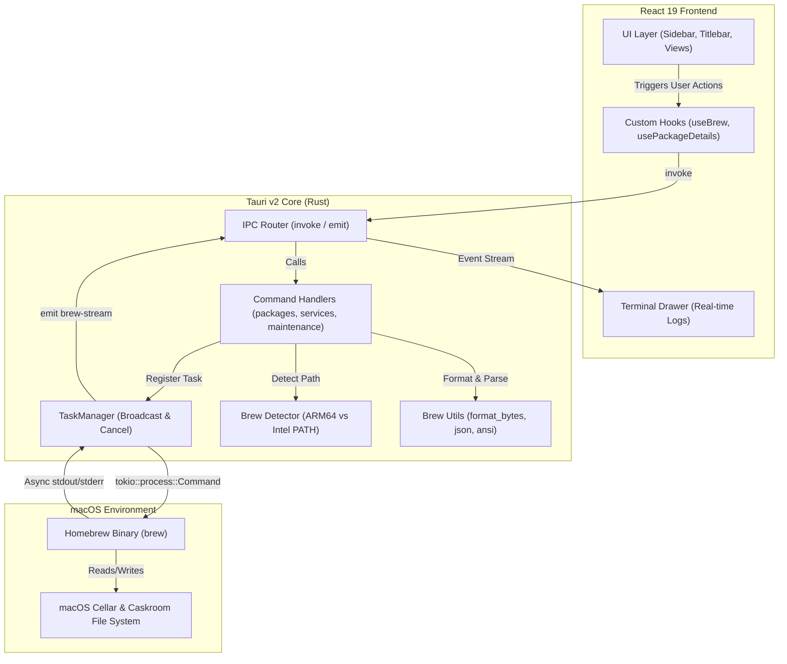
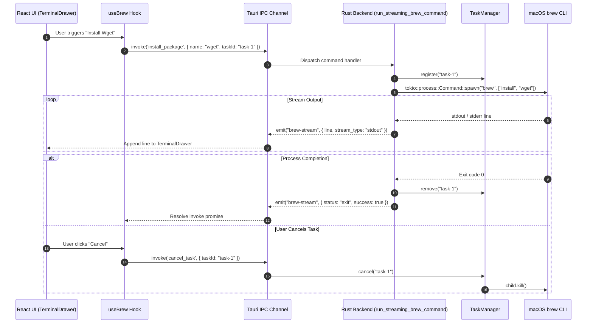

# Brewi - Architecture Overview

**Brewi** is built using a modern, lightweight hybrid desktop architecture combining **Tauri v2 (Rust)** for system interaction and process execution with **React 19 (TypeScript)** for a responsive macOS glassmorphism UI.

---

## 🏗️ System Architecture & Data Flow



---

## 🔄 Task Execution & Real-Time Event Sequence



---

## 📁 Directory Structure

```text
brewi/
├── .github/workflows/       # GitHub Actions CI/CD pipelines
│   └── test.yml             # Automated Vitest & Cargo test workflow
├── docs/                    # Architectural & project documentation
│   ├── ARCHITECTURE.md      # System overview & design patterns
│   ├── TESTING.md           # Test suite guide & commands
│   ├── CONTRIBUTING.md      # Developer guidelines & coding standards
│   └── FEATURES.md          # Detailed feature catalog
├── src/                     # React 19 Frontend
│   ├── components/          # Categorized UI components
│   │   ├── common/          # Toast, Spinner, ConfirmModal, EmptyState, etc.
│   │   ├── layout/          # Sidebar, Titlebar, TerminalDrawer
│   │   ├── maintenance/     # DoctorView, CleanupView, BrewfileView
│   │   ├── packages/        # PackageList, PackageCard, PackageRow, Modals
│   │   ├── services/        # ServicesView
│   │   ├── taps/            # TapsView
│   │   └── updates/         # UpdatesView
│   ├── hooks/               # Custom React hooks (useBrew, usePackageDetails, etc.)
│   ├── tests/               # Vitest component, hook, and utility tests
│   ├── types/               # TypeScript interfaces & types
│   ├── utils/               # Shared formatters, constants, and ANSI parser
│   └── App.tsx              # Root workspace component
└── src-tauri/               # Tauri v2 Rust Backend
    └── src/
        ├── brew/            # Core Homebrew wrappers
        │   ├── cli.rs       # Streaming process execution & TaskManager
        │   ├── detector.rs  # Homebrew binary & macOS environment detection
        │   ├── models.rs    # Rust structs for JSON serialization
        │   └── utils.rs     # Shared Rust byte formatting & size utilities
        ├── commands/        # Tauri command handlers
        │   ├── maintenance.rs
        │   ├── packages.rs
        │   ├── services.rs
        │   ├── system.rs
        │   └── taps.rs
        └── tests/           # Cargo unit test suite
```

---

## ⚡ IPC Communication & Async Streaming

1. **Commands (`invoke`)**:
   - The frontend calls Tauri IPC commands via `invoke<T>('command_name', { args })`.
   - Backend functions execute asynchronously using `tokio` threads to prevent UI locking.

2. **Event Streaming (`emit` / `listen`)**:
   - Long-running commands (e.g. `brew install`, `brew cleanup`, `brew upgrade`) use `run_streaming_brew_command`.
   - Output lines are emitted in real-time over the `"brew-stream"` event channel to populate the `TerminalDrawer` console log.

3. **Cancellation (`TaskManager`)**:
   - Each streaming command registers a `task_id` with `TaskManager`.
   - Users can cancel running processes instantly by invoking `cancel_task(task_id)`, sending a termination signal to the child process.
